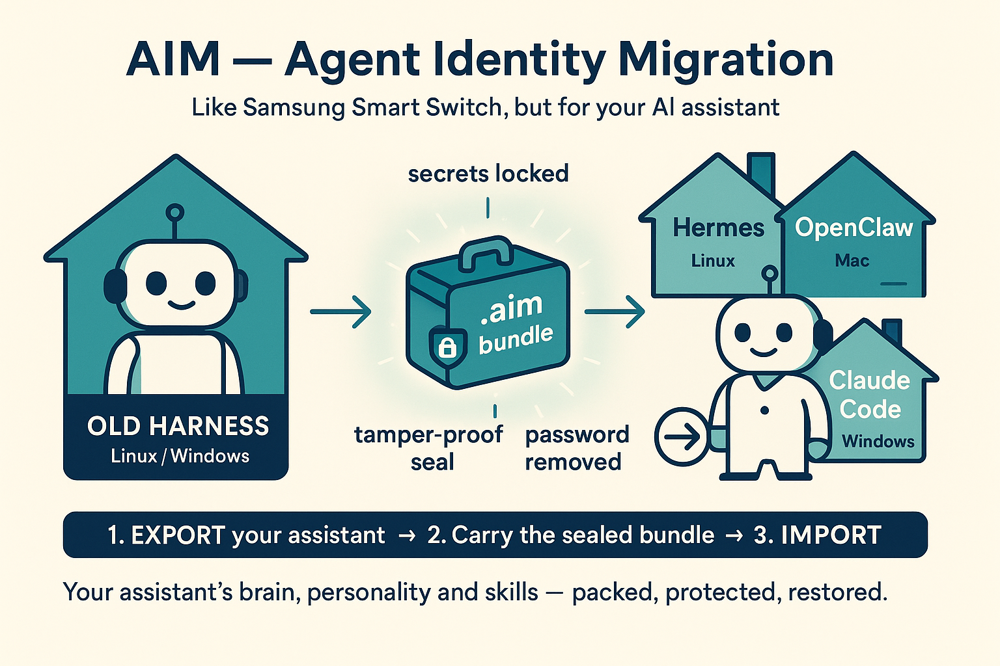

# AIM — Agent Identity Migration



**"Samsung Smart Switch" for AI agents:** migrate a stateful agent's persona,
memories, skills, cron jobs, config, and MCP bindings between *harnesses*
(Hermes ↔ OpenClaw ↔ Claude Code ↔ Codex CLI ↔ OpenCode ↔ Goose ↔ Buzz ↔ Grok Build)
and *operating systems* (Linux, WSL2, macOS, Windows).

Uses a neutral **Canonical Intermediate Format** (`.aim` zip bundle) so migration
is N adapters, not N² point-to-point converters. Design spec: see
`docs/SPEC.md` (v2, Opus-reviewed).

## Quick start (dev, zero-install)

```bash
cd ~/projects/aim
export PYTHONPATH=src

# Export the live Hermes agent (redaction gate blocks if secrets detected)
python3 -m aim.cli export --harness hermes --home ~/.hermes -o agent.aim

# Preview what lands where before writing anything
python3 -m aim.cli plan agent.aim --harness openclaw

# Import into another harness home (transactional: backup + atomic swap)
OPENCLAW_HOME=/path/to/.openclaw python3 -m aim.cli import agent.aim \
    --harness openclaw --force --map /home/hal=/Users/rory

python3 -m aim.cli list agent.aim
python3 -m aim.cli adapters list
```

Requires: python3 with `click pydantic pyyaml cryptography pytest`.

## Adapters

| Harness | Persona | Memory | Skills | Config | MCP | Cron |
|---|---|---|---|---|---|---|
| Hermes | SOUL.md | memories/ | skills/ | yaml | ✓ | ✓ |
| OpenClaw | personality | memory store | skills | json | ✓ | ✓ |
| Claude Code | CLAUDE.md | projects/*/memory | skills/ | — | .claude.json | park |
| Codex CLI | AGENTS.md | — | skills/ + .agents/skills | config.toml | — | park |
| OpenCode | AGENTS.md | — | skills/ | opencode.json | — | park |
| Goose | AGENTS.md | sessions (opt-in) | skills/ | config.yaml | extensions | park |
| Buzz | personas/ | relay-side (opt-in) | skills/ | agents/*.yaml | dev-mcp | workflows |
| Grok Build | AGENTS.md | — | skills/ | settings.json | — | park |

## Testing

- `pytest tests/` — 28 unit/round-trip tests
- CI matrix: ubuntu + macOS + Windows on every push
- `tests/e2e/container_test.sh` — fully isolated Docker E2E (repo read-only,
  throwaway workdir, `--network none`): secrets leak check, wrong-passphrase
  rejection, cross-harness imports, full suite

## Guarantees

- **Integrity**: every file sha256-hashed in manifest; import refuses on any mismatch
- **Secrets**: gitleaks-style redaction scan at export; export *fails* on
  secret-like spans unless `--allow-unredacted`. Optional `--with-secrets`
  builds an encrypted vault (age-style scrypt + ChaCha20-Poly1305) inside the
  bundle; `import --passphrase` restores values byte-exact
- **Transactionality**: staged copy → validate → atomic rename; 0600 backup;
  refuses if target harness process is running (override `--force`)
- **Lossless-first**: skills copy verbatim (mode bits preserved); unsupportable
  items (e.g. cron jobs into Claude Code) are parked to `unsupported/`, never dropped silently
- **Cross-OS paths**: `--map src=dst` rewrites path references; all rewrites logged

## Status (v0.1, 2026-10-14)

- ✅ Hermes ↔ OpenClaw + Claude Code, Linux — 15/15 tests, live-agent E2E verified
- 🔜 v1.1: age-encrypted secrets vault, native Windows, real-OpenClaw layout verification
- 🔜 v2: Codex/Kilo adapters, container cross-OS test matrix

## Known-history bugs (kept for the record)

- `def list()` in cli.py shadowed builtin `list` → `list(maps)` executed the
  `aim list` click command (fixed, regression test in tests/test_roundtrip.py)
